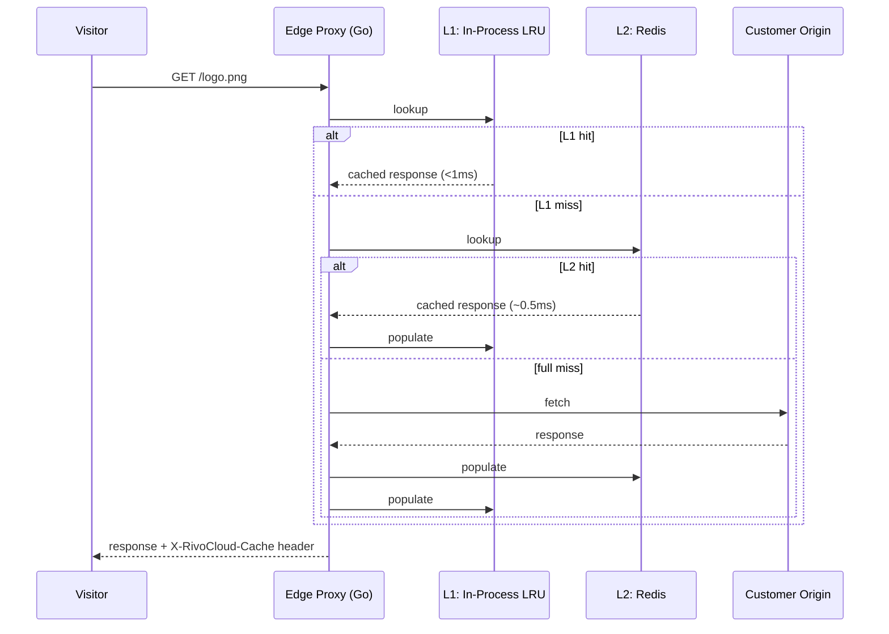
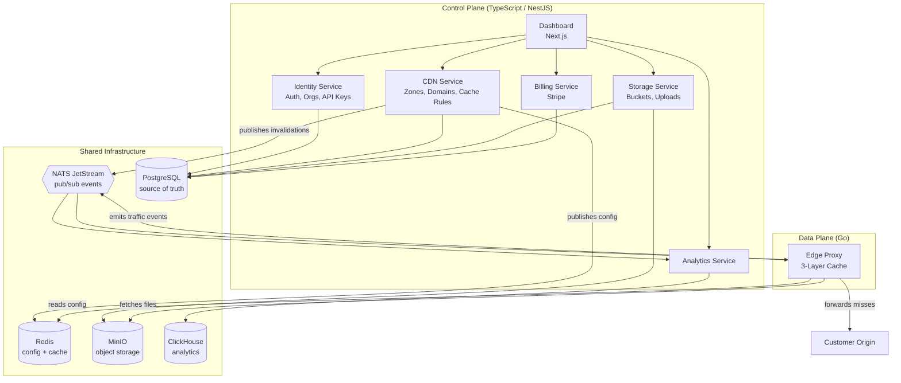
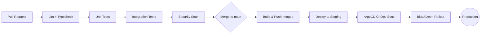
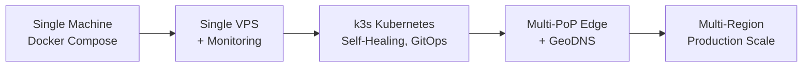
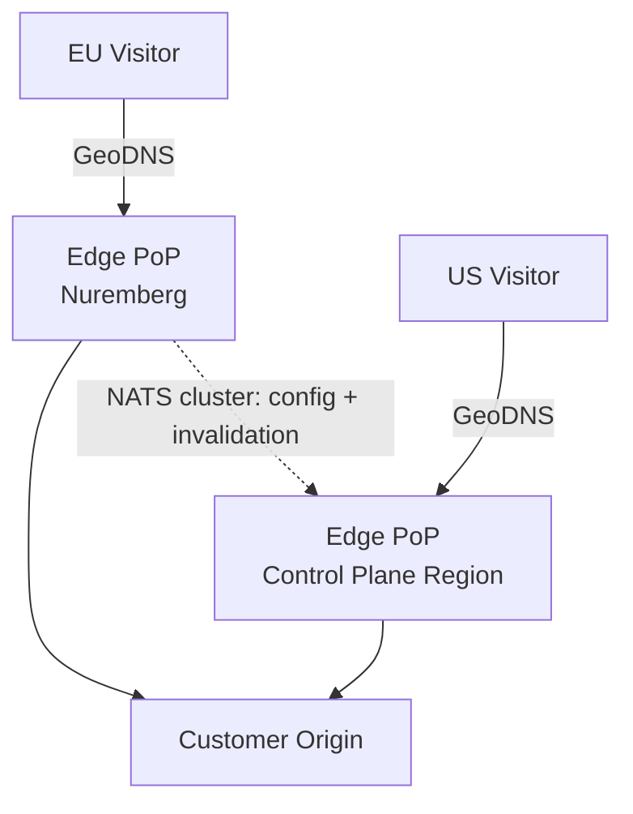
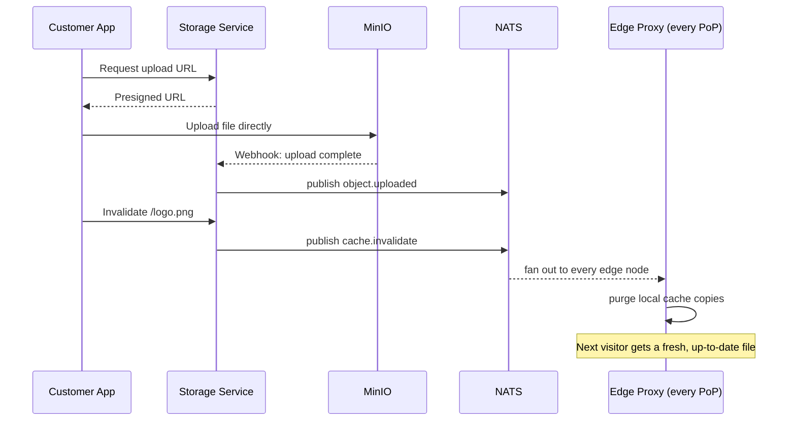

# RivoCloud

### An edge-first CDN, object storage, and delivery platform — built from scratch

RivoCloud is a full-stack cloud infrastructure product: a content delivery network (CDN), S3-compatible object storage, cache management, real-time analytics, and billing, unified behind a single dashboard, REST API, SDK, and CLI. It occupies the space between simple CDNs (Bunny.net) and full hyperscale clouds (AWS, Cloudflare) — offering the depth of a serious CDN with the developer experience of a modern platform.

---

## 1. Overview & Features

### What it is

A customer creates a **zone** pointing at their own server (their "origin"). RivoCloud's edge network then caches and serves that traffic globally, so visitors get content from the server closest to them instead of round-tripping to the origin every time. Customers can also push files directly into RivoCloud's own object storage and serve them straight from the CDN, with no origin server involved at all.

Everything — creating zones, uploading files, managing domains, purging caches, watching traffic analytics, and paying the bill — happens through one dashboard, one REST API, and one identity/permissions model.

### Key Features

| Area                           | What it delivers                                                                                                                                                                                 |
| ------------------------------ | ------------------------------------------------------------------------------------------------------------------------------------------------------------------------------------------------ |
| **CDN Core**             | Origin-pull and origin-push CDN, 3-layer cache (in-process → Redis → object storage), smart cache-key normalization, ETag/conditional requests, gzip + brotli compression, HTTP range requests |
| **Custom Domains**       | Bring-your-own domain with fully automatic TLS certificate issuance and renewal (Let's Encrypt) — no manual certificate handling, ever                                                          |
| **Object Storage**       | S3-compatible buckets and objects, direct-to-storage presigned uploads, multipart upload for large files, versioning-ready schema                                                                |
| **Cache Management**     | Per-path cache rules (glob-matched, priority-ordered), instant global purge by path or tag, propagated in seconds across every edge node via pub/sub                                             |
| **Signed URLs**          | HMAC-signed, time-limited links for controlled access to private content, verified at the edge with zero round-trips to the origin service                                                       |
| **Analytics**            | Real-time bandwidth, cache hit ratio, geography, latency (P95), and status-code breakdowns per zone                                                                                              |
| **Security & Access**    | Organizations, role-based access control (Owner/Admin/Developer/Viewer), scoped API keys, full audit logging, sliding-window rate limiting                                                       |
| **Billing**              | Stripe-powered subscriptions, usage-based plan enforcement, self-serve billing portal                                                                                                            |
| **Global Edge**          | Multiple physical Points of Presence (PoPs) with GeoDNS routing visitors to the nearest one                                                                                                      |
| **Developer Experience** | Full REST API, a JavaScript/TypeScript SDK, and a Go CLI — every dashboard action is also a one-line script                                                                                     |

### Why It's Different

|                  | Cloudflare         | Bunny.net   | AWS CloudFront | **RivoCloud**                     |
| ---------------- | ------------------ | ----------- | -------------- | --------------------------------------- |
| CDN              | Excellent          | Good        | Good           | Good → Excellent                       |
| Object Storage   | R2 (S3-compatible) | B2          | S3             | S3-compatible, built in                 |
| Self-hostable    | No                 | No          | No             | **Yes (open core)**               |
| Pricing          | Opaque             | Transparent | Complex        | **Transparent, usage-based**      |
| Unified platform | Partial            | No          | No             | **Yes — one dashboard, one API** |

---

## 2. Technical Implementation & Workflow

### Architectural Philosophy: Two Worlds

RivoCloud is deliberately split into two halves that are optimized for opposite things:

- **The Control Plane** ("the office") — configuration and management: creating zones, managing billing, viewing analytics. Built for correctness and safety, in TypeScript/NestJS microservices.
- **The Data Plane** ("the front counter") — the part that touches every single visitor request, all day. Built for raw speed, in Go.

The two communicate only through fast, disposable infrastructure (Redis for config, NATS for events) — never by calling each other's APIs directly on the hot path. This is the single most important architectural decision in the system: it means the CDN never gets slower no matter how much configuration or business logic the control plane accumulates.

### How a Request Is Served (Cache Hit Path)

### How the System Fits Together

### Implementation Workflow

The platform was delivered as 16 sequenced build stages, each unlocking the next — infrastructure first, then identity, then the core caching engine, then the management layer around it, and finally the polish needed for a public launch:

1. **Foundation** — monorepo, Docker Compose, database schema, CI pipeline
2. **Identity & Access** — auth, organizations, API keys, the shared auth guard every later service reuses
3. **Edge Proxy core** — the Go caching engine, built and validated before anything depends on it
4. **CDN Service** — zone management, publishing configuration to the edge in real time
5. **Object Storage** — buckets, presigned uploads, storage-backed CDN serving
6. **Dashboard** — built incrementally, one feature at a time, alongside each backend service
7. **Cache invalidation & rules** — global purge and per-path TTL logic over pub/sub
8. **Custom domains & TLS** — dynamic routing plus fully automated certificates
9. **Analytics** — a full event pipeline from edge traffic to real-time dashboard charts
10. **Signed URLs** — cryptographically controlled access to private content
11. **Security hardening** — RBAC enforcement, audit logging, and rate limiting across every service
12. **Billing** — Stripe-powered subscriptions and usage-based plan limits
13. **Kubernetes migration** — moved from single-node Docker Compose to a self-healing k3s cluster with GitOps
14. **Global edge expansion** — additional physical PoPs with GeoDNS routing
15. **SDK & CLI** — first-class developer tooling wrapping the stable REST API
16. **Public launch** — documentation site, landing page, status page, and onboarding polish

---

## 3. Tech Stack

| Layer                             | Technology                                                                                               |
| --------------------------------- | -------------------------------------------------------------------------------------------------------- |
| **Data Plane (Edge Proxy)** | Go — chosen for predictable low-latency concurrency with no GC-pause surprises under heavy request load |
| **Control Plane Services**  | TypeScript, NestJS (Identity, CDN, Storage, Analytics, Billing, Notification, Scheduler services)        |
| **Frontend / Dashboard**    | Next.js, React, shadcn/ui, TanStack Query, Recharts                                                      |
| **Primary Database**        | PostgreSQL — durable source of truth (users, orgs, zones, buckets, billing)                             |
| **Cache & Fast Store**      | Redis — edge configuration cache, sessions, rate-limit counters                                         |
| **Object Storage**          | MinIO — S3-compatible, self-hosted                                                                      |
| **Analytics Database**      | ClickHouse — columnar store for high-volume request-log aggregation                                     |
| **Messaging / Events**      | NATS (JetStream) — pub/sub for cache invalidation and analytics event streaming                         |
| **Reverse Proxy / TLS**     | Traefik — dynamic routing plus automatic Let's Encrypt certificate management                           |
| **Payments**                | Stripe — Checkout, subscriptions, webhooks, Customer Portal                                             |
| **SDK / CLI**               | JavaScript/TypeScript SDK, Go CLI (Cobra)                                                                |
| **Containerization**        | Docker Compose (development, early production) →**Kubernetes (k3s)** (scaled production)          |
| **GitOps / Deployment**     | ArgoCD — Git as the single source of truth for what's deployed                                          |
| **Observability**           | OpenTelemetry (traces + metrics), Prometheus, Grafana, Loki                                              |
| **Monorepo Tooling**        | pnpm workspaces, Turborepo, Prisma ORM, Zod, ESLint, Vitest                                              |
| **CI/CD**                   | GitHub Actions                                                                                           |

---

## 4. CI/CD Workflow

Every change flows through the same automated pipeline before it ever reaches production — no manual deploy steps, no "it works on my machine."

**On every pull request:**

1. **Lint & Typecheck** — static analysis across every package in the monorepo (Turborepo runs only what changed)
2. **Unit Tests** — fast, isolated tests per service
3. **Integration Tests** — run against real Postgres/Redis/MinIO instances spun up in CI, not mocks
4. **Security Scan** — dependency and code scanning before merge is allowed

**On merge to `main`:**
5. **Build** — container images built and pushed for every service
6. **Deploy to Staging** — automatic, for smoke-testing in a production-like environment
7. **GitOps Sync (Production)** — ArgoCD detects the updated desired state in Git and rolls it out to the Kubernetes cluster automatically, with health checks gating the rollout
8. **Blue/Green Cutover** — the new version runs alongside the old one; traffic switches over only once it's verified healthy, so a bad deploy can be reverted instantly

---

## 5. Diagrams

### System Scaling Path

RivoCloud was deliberately built to scale up in stages rather than over-engineered from day one — each stage solves the actual bottleneck the previous one hit.

### Global Traffic Routing

### Upload & Cache-Invalidation Flow

---

## 6. Case Studies & Use Cases

### Use Case 1 — The Indie SaaS Founder

**Challenge:** A solo developer's SaaS product serves images and API responses from a single origin server. Global users complain about slow load times, and juggling a separate CDN provider and object storage provider means two bills, two dashboards, two SDKs.
**Solution:** Point the app at RivoCloud. One zone caches the API responses with custom per-path TTL rules; one bucket stores and serves user-uploaded images directly through the CDN — no separate storage vendor needed.
**Outcome:** A single dashboard and API key covers both CDN and storage, with a transparent usage-based bill instead of two separate opaque ones.

### Use Case 2 — The Media-Heavy E-Commerce Platform

**Challenge:** A growing online store serves thousands of product images and needs instant cache purges whenever inventory photos change — stale images showing the wrong product is a lost sale.
**Solution:** Origin-push storage holds every product image; cache rules cache them aggressively (long TTL); a single "invalidate by tag" call purges every image tied to an updated product across every edge location within seconds.
**Outcome:** Fast page loads worldwide, with content updates reflected instantly instead of waiting out a cache TTL.

### Use Case 3 — The API-First Startup Team

**Challenge:** A small engineering team needs to expose a versioned API to third-party developers, with teammates who need different levels of access (an intern shouldn't be able to touch billing).
**Solution:** Organizations with role-based access control (Owner/Admin/Developer/Viewer) let the team scope exactly who can create zones, invalidate caches, or manage billing — enforced identically whether the action comes from the dashboard, the API, or the CLI.
**Outcome:** Safe, auditable collaboration with zero custom permission code written by the team themselves.

### Use Case 4 — The DevOps-Forward Engineering Org

**Challenge:** A platform team wants CDN operations wired into their existing deployment pipeline — cache purges should happen automatically after every deploy, not be a manual dashboard click someone forgets.
**Solution:** The Go CLI drops into any CI pipeline (`rivocloud cache invalidate /assets/*` as a post-deploy step); the JS/TS SDK covers anything that needs to happen from application code instead of a script.
**Outcome:** Cache invalidation becomes part of the deploy pipeline itself — one less manual step, one less way to ship stale content.

---

## Project Links

- **Live Demo / Dashboard:** _[[rivo-cloud.vercel.app](https://rivo-cloud.vercel.app/)]_

---

*RivoCloud — a unified CDN, storage, and delivery platform, designed and built end-to-end: architecture, backend microservices, a Go-based edge caching engine, a full dashboard, and production CI/CD/GitOps deployment.*
