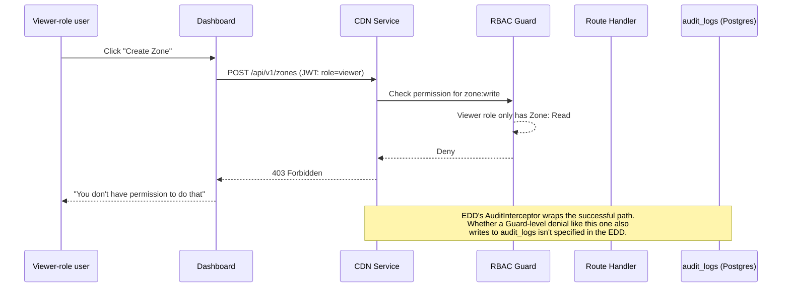

# Security, RBAC & Audit Logging — Explained for Beginners

This document explains the concepts behind **Stage 11 — Security + RBAC** (target: Month 6) of RivoCloud's Phase 1 build. It assumes you've read [`phase1-explained-for-beginners.md`](../phase1-explained-for-beginners.md), especially its **RBAC**, **Audit Log**, and **Rate Limiting** glossary entries (Section 3.4) — this document goes deeper on all three, plus adds secret management and encryption basics.

**This stage is built.** The summary below describes the system as it was actually implemented; the sections that follow explain the underlying concepts and were written before the code existed, so where they differ, this summary wins.

### As built

- **Shared package.** `@rivocloud/security` (consumed from source by every service) holds the role-to-scope table (`src/rbac/scopes.ts`, no imports), a single `ScopeGuard` with `@RequireScope` (deny-by-default: a route with no declared scope is rejected), the `RateLimitInterceptor`, the `AuditInterceptor` and `AuditWriter`, `SecurityModule.forRoot`, and `configureTrustProxy`.
- **Live roles.** Org routes check membership of the organization named in the URL (`OrgMemberGuard`, 404 for non-members) and read the role from the database on every request. `verify-token` returns the live role, and answers 401 ("No longer a member of this organization") if the user was removed. API keys are capped at their creator's live role and stop working once the creator leaves the org; editing a key's permissions is capped the same way. The members list no longer exposes password hashes, PATCH on an API key no longer returns `keyHash`, and the API-key view includes the creator's `userId`.
- **Member rules.** Nobody can assign `owner`; only an Owner can change roles; an Admin may invite or remove only developers and viewers. API keys: owner/admin manage any key, everyone else only their own.
- **`analytics:read`.** Analytics API keys now need the `analytics:read` scope (previously `zone:read`). CDN, Storage and Analytics all adopted the shared `ScopeGuard`.
- **Audit logging.** Each mutating handler opts in with `@Audit(action, options)` or explicitly with `@NoAudit()`; a `findUnauditedMutations` unit test in every service fails if a mutation has neither. The audit write is awaited, but a failure to write never fails the request. Only allowlisted `bodyFields` are copied into the record. Session endpoints (`api/v1/auth/*`) and `internal/*` routes are not audited; `user.*` account events are stored with `orgId = null`, so they do not appear on any org's audit page. Owners and admins read the log via `GET /api/v1/orgs/:orgId/audit-logs` (cursor pagination) or the dashboard's Settings page.
- **Rate limiting.** A Redis sliding window (ZADD/ZCARD inside MULTI, no Lua). It fails open on Redis errors, and each limiter call is bounded (250 ms) so a Redis outage does not stall requests while ioredis retries; it answers 429 with `Retry-After`. Policies: auth login and register 10/min per IP; forgot-password 5/hour per IP; cache invalidation 100/min per zone; analytics queries 60/min per user or key; a general 1000/min per user or key shared across services. `RATE_LIMIT_ENABLED` (default true) turns it off; integration test configs set it false.
- **`TRUST_PROXY`.** Controls which proxies' `X-Forwarded-For` is believed when deriving the client IP (default `loopback, linklocal, uniquelocal`). The dashboard forwards the browser's `X-Forwarded-For` and `User-Agent` on every backend call so audit records and per-IP limits see the real client.
- **Deployment requirement: a rewriting proxy in front of the dashboard.** The dashboard relays the `X-Forwarded-For` it receives unchanged, and the services trust it because the dashboard is a private hop. So the dashboard must sit behind a reverse proxy (for example Traefik with its default `forwardedHeaders` handling, i.e. no `insecure`/`trustedIPs` for public clients) that overwrites or appends `X-Forwarded-For` with the real client address, and the services must be reachable only from private networks. Without that proxy, a browser can send its own `X-Forwarded-For` and spoof the IP used for per-IP rate limits and audit records; if no proxy adds the header at all, every user shares the dashboard's own IP and therefore one per-IP rate-limit bucket.
- **Dashboard.** A Settings page with Members, API keys, and (for owner/admin) the Audit log.
- **Non-goals (deferred).** Billing permissions (Stage 12); Notification Service and webhooks; per-IP limiting at the edge proxy; Traefik/Cloudflare control-plane limits; audit retention and MinIO archive; logging denied attempts; ownership transfer; the scheduler (internal-only).

**A note on scope:** the Identity Service (Stage 2, see [`identity-service-and-auth.md`](identity-service-and-auth.md)) already introduces the basics of RBAC — what a role is, the four roles (Owner/Admin/Developer/Viewer), and the `AuthGuard` that figures out *who* is calling (via JWT or API key) and attaches their role to the request. This document does not re-explain that. Instead, it focuses on the three things Stage 11 specifically adds on top of that foundation: **enforcing** those roles inside every service's routes, **recording** every mutation automatically, and **limiting** how fast anyone can hit the API.

---

## 1. Why is this its own late stage, instead of built-in from day one?

This is arguably the most important thing to understand before diving into the mechanics — it's a deliberate, stated tradeoff, not an oversight.

Look at the [16-stage build order](../phase1-explained-for-beginners.md#5-how-phase-1-is-built-the-16-stages) again: Stage 2 (Identity Service, Month 1) builds *authentication* — logging in, knowing who a user is, and attaching their role to every request via the `AuthGuard`. But Stage 11 (Month 6) is when that role information actually gets **checked** before every single mutating action, across every one of the ~8 microservices, and when every mutation starts getting written down.

Why leave a five-month gap between "the system knows your role" and "the system actually enforces your role everywhere"? The EDD and PRD are explicit about the tradeoff:

- **During internal development, moving fast matters more than airtight enforcement.** For the first several months, the only people calling these APIs are RivoCloud's own developers and (later) a small number of trusted internal testers — there is no real customer data at stake yet, and no zones, buckets, or billing records belonging to a paying stranger. Requiring every new route in every new service to also ship a complete permission check, from the very first day that service exists, would slow down exactly the stages (Edge Proxy, CDN Service, Storage Service, Analytics) where the *hardest, riskiest* technical problems are being solved. Stage 3's Edge Proxy validates whether the caching architecture works at all — that's the risk worth spending effort on early, not "can a Developer role invalidate cache."
- **It cannot be skipped forever, though.** The PRD's risk table states this plainly: *"Building RBAC/audit/rate-limiting last (Stage 11) means early stages temporarily lack full enforcement. Acceptable during internal development with no real customer data; Stage 11 must land before Stage 16 (Public Beta)."* Once real strangers can sign up and store their own zones, buckets, and payment details, "temporarily lacking enforcement" stops being an acceptable risk — a Viewer-role teammate accidentally (or a malicious actor deliberately) deleting a zone they should only be able to read becomes a real incident, not a hypothetical one.
- **It's ordered last on purpose, not by neglect.** Stage 11 needs *every other service to already exist* so it has something to add enforcement, audit logging, and rate limiting *to* (see Section 7 below). Building it earlier would mean adding permission checks to services that don't exist yet, or retrofitting them twice.

So the sequencing is: build the *engine* (caching, zones, storage, analytics) first while the blast radius of a mistake is small, then bolt on the *seatbelt* (enforcement, logging, rate limits) everywhere at once, and make sure the seatbelt is fully on **before** Stage 16 opens the doors to the public.

---

## 2. What's already there vs. what Stage 11 adds

| | Built in Stage 2 (Identity Service) | Added in Stage 11 (Security + RBAC) |
|---|---|---|
| Knows who's calling | Yes — `AuthGuard` verifies the JWT or API key and attaches `request.auth = { userId, orgId, role }` (or `{ apiKey, permissions }`) | — |
| Roles exist as data | Yes — `role` column on organization membership: `owner`, `admin`, `developer`, `viewer` | — |
| Roles are actually *checked* per action | No — a route could ignore `request.auth.role` entirely and let anyone through | Yes — every mutating route in every service checks the caller's role/permission scope before executing |
| Every mutation is written down somewhere | No | Yes — an audit logging interceptor records every mutation automatically |
| Requests are throttled | No | Yes — rate limiting middleware, especially strict on auth endpoints |

The role permission matrix itself (which role can do what) is defined once, in the EDD (Section 8.2), and is worth a quick recap here since Stage 11 is what actually makes it true:

| Role | Zone | Storage | Analytics | Billing | Members | Settings |
|---|---|---|---|---|---|---|
| Owner | Full | Full | Full | Full | Full | Full |
| Admin | Full | Full | Full | Read | Invite/Remove | Full |
| Developer | Full | Full | Full | None | None | Read |
| Viewer | Read | Read | Full | None | None | None |

API keys carry their own fine-grained **permission scopes** (`zone:read`, `zone:write`, `zone:delete`, `cache:invalidate`, `storage:read`, `storage:write`, `storage:delete`, `analytics:read`, `billing:read`) — an API key can never be granted more than the role of the user who created it, even if the key's scopes are a subset chosen freely.

---

## 3. What's an "interceptor"? (in plain language)

NestJS (the framework behind every control-plane service) has several kinds of code that can wrap around a request automatically, without the person writing a route handler needing to remember to call anything. A **Guard** decides *whether a request is allowed through at all* (yes/no, checked before the handler runs). An **Interceptor** is similar but broader: it's a piece of code that wraps *around* the handler on both sides — it can run logic before the handler executes and after it finishes (or after it errors) — without every single route needing its own copy-pasted logic.

Think of an interceptor like a security camera bolted above every doorway in a building, rather than asking each employee to personally write down every time they walk through a door. It doesn't matter whether the employee is trustworthy or forgetful — the camera runs the same way for everyone, every time, automatically.

For audit logging specifically (EDD Section 8.7), this means: instead of every one of the ~8 microservices' route handlers remembering to write "I just did X" into a table, one `AuditInterceptor` is registered once, and it automatically fires after *any* mutating route finishes, recording the action — no individual developer can forget to log a zone deletion, because the logging isn't their responsibility to remember at all.

```typescript
@Injectable()
export class AuditInterceptor implements NestInterceptor {
  intercept(context: ExecutionContext, next: CallHandler) {
    const request = context.switchToHttp().getRequest();
    return next.handle().pipe(
      tap(() => this.auditService.log({
        orgId: request.auth.orgId,
        userId: request.auth.userId,
        action: `${request.method.toLowerCase()}.${context.getClass().name.toLowerCase()}`,
        resourceType: request.params.resourceType,
        resourceId: request.params.id,
        ipAddress: request.ip,
        requestId: request.headers['x-request-id'],
      }))
    );
  }
}
```
*(EDD Section 8.7 — the actual interceptor Stage 11 is expected to add.)*

One subtlety worth flagging for later, since it matters for the walkthrough in Section 6: in NestJS, **Guards run before Interceptors**. A Guard that rejects a request (e.g., "this Viewer isn't allowed to create a zone") throws before the handler — and before this particular interceptor — ever runs. The EDD's interceptor code above only wraps `next.handle()`, i.e. the successful path through the handler. Whether RBAC-denied attempts also get written to `audit_logs` (via the Guard itself, a separate exception filter, or some other mechanism) isn't spelled out in the EDD — see Section 6 for how this doc handles that gap honestly.

---

## 4. Audit logs, in depth

An **audit log** is a permanent record of "who did what, to what, and when." The EDD defines the exact table (Section 6):

```sql
CREATE TABLE audit_logs (
  id              BIGSERIAL PRIMARY KEY,
  org_id          UUID REFERENCES organizations(id) ON DELETE SET NULL,
  user_id         UUID REFERENCES users(id) ON DELETE SET NULL,
  api_key_id      UUID REFERENCES api_keys(id) ON DELETE SET NULL,
  action          TEXT NOT NULL,                 -- 'zone.created', 'cache.invalidated', etc.
  resource_type   TEXT,
  resource_id     TEXT,
  ip_address      INET,
  user_agent      TEXT,
  request_id      TEXT,
  metadata        JSONB NOT NULL DEFAULT '{}',
  created_at      TIMESTAMPTZ NOT NULL DEFAULT now()
);
```

**What gets recorded, per row:**
- **Who** — the `user_id` (or `api_key_id`, if the call came from an API key rather than a logged-in person) and the `org_id` they belong to.
- **What action** — a string like `zone.created` or `cache.invalidated`, plus which `resource_type`/`resource_id` it touched (e.g., "zone", `zone_abc123`).
- **When** — `created_at`, set automatically by Postgres.
- **Where from** — `ip_address`, `user_agent`, and a `request_id` (so this row can be cross-referenced against logs/traces for the same request elsewhere in the system).

**Why append-only?** The EDD states plainly: *"Audit logs are append-only (no UPDATE or DELETE on `audit_logs`)."* An audit log that could be edited or deleted after the fact would be useless as a security record — the whole point is that if something goes wrong, nobody (including a compromised admin account) can quietly erase the evidence. Retention is 90 days in the live table, after which rows are archived to MinIO as compressed JSON rather than deleted outright.

**What it's used for:** the canonical example from this document's brief is exactly the kind of question audit logs exist to answer — *"who deleted zone Y at 3pm?"* More broadly: security incident review (did an attacker's compromised API key do anything destructive, and when), accountability inside a team (which Developer changed this cache rule), and compliance/support (a customer asks "did anyone touch my billing settings last week?"). The PRD's Deliverable for Month 6 is explicit: *"Audit logs visible in dashboard"* — Owners and Admins are meant to be able to browse this history themselves, not just have it sit in a database only engineers can query.

---

## 5. Rate limiting, in depth

**Rate limiting** restricts how many requests a given IP address, user, or API key can make in a given time window, so that one abusive or buggy client can't overwhelm the system or brute-force something like a login form.

### The sliding window algorithm, in plain language

A naive ("fixed window") rate limiter resets its counter at the top of every minute — e.g., "at most 10 requests per calendar minute." The problem: a client can send 10 requests in the last second of minute 1, then another 10 in the first second of minute 2 — 20 requests in two seconds, technically obeying the rule, but clearly not the *intent* of "10 per minute." This is the classic "burst at the boundary" problem.

A **sliding window** avoids this by not resetting on a clock tick at all. Instead, it counts however many requests happened in the *trailing* time window ending right now — e.g., "how many requests came from this IP in the last 60 seconds, measured continuously," rather than "how many since the clock struck the minute." Every new request slides the window forward by however much time has passed, so there's never a hard reset moment for a burst to hide around.

The EDD's concrete implementation (Section 8.3) uses Redis's sorted sets: `ZADD` adds the current request's timestamp as a score into a per-key sorted set, and `ZCOUNT` (or an equivalent range count) counts how many timestamps fall within the last N seconds — old entries outside the window get trimmed away. The EDD notes this needs *"no Lua scripts required,"* i.e., it's simple enough to implement with plain Redis commands rather than custom server-side scripting.

### Why Redis is a natural fit

Rate limiting needs to answer "how many requests has this key made recently?" fast, on every single incoming request, for potentially thousands of distinct keys (IPs, users, API keys) at once. Redis is an in-memory store (see the Redis glossary entry in [`phase1-explained-for-beginners.md`](../phase1-explained-for-beginners.md#33-core-infrastructure-pieces-the-ingredients)) — reads and writes happen in RAM, so a `ZADD`/`ZCOUNT` pair completes in well under a millisecond. Doing the equivalent bookkeeping in PostgreSQL (a durable, disk-backed database) on every request would be far slower and would pile unnecessary write load onto the one database that's supposed to be the durable source of truth for everything else. Rate-limit counters are also inherently disposable — losing them on a Redis restart just means the count starts over, which is an acceptable, low-stakes failure mode (exactly the same reasoning that makes Redis right for CDN caching).

### The actual limits (EDD Section 8.3)

| Endpoint Category | Limit | Window | Key |
|---|---|---|---|
| Auth: login, register | 10 req | 1 minute | IP address |
| Auth: forgot password | 5 req | 1 hour | IP address |
| API: general | 1,000 req | 1 minute | API key or user JWT |
| API: cache invalidation | 100 req | 1 minute | Zone ID |
| API: analytics | 60 req | 1 minute | User JWT |
| Edge: CDN requests | Configurable per zone | — | — |

**Why auth endpoints specifically need the strictest limit:** login and registration are the one place an attacker gets to *guess* — trying password after password against an account, hoping to get lucky (a "brute-force" attack). General API endpoints are already gated by a valid JWT or API key, so the attacker would need to have gotten in already; login endpoints are gated by nothing but a password guess, which is exactly what makes them the highest-value target for automated abuse. Limiting login/register to 10 requests per minute *per IP address* (not per user — the attacker doesn't have a valid user session yet) makes large-scale password guessing impractically slow without materially inconveniencing a real person who just mistyped their password a couple of times. This same sliding-window mechanism, applied at the Edge Proxy layer (Layer 7) rather than the control plane, is also one of RivoCloud's stated DDoS protection measures (EDD Section 8.6): per-IP rate limiting, a 100-concurrent-connection cap per IP, and Traefik-level rate limiting in front of the control plane, alongside Hetzner's own network-level (Layer 3/4) mitigation and `fail2ban`.

---

## 6. Secret management and encryption, briefly

Two more pieces round out "Security Architecture" (EDD Section 8), even though they're not really about RBAC:

**Secrets are never committed to git.** In development, each service reads configuration from a local `.env` file; only a `.env.example` (with placeholder values, no real secrets) is committed. A Zod schema (`packages/config/src/env.ts`) validates that all required environment variables are present at startup, so a missing secret fails loudly and immediately rather than causing a mysterious runtime error later. In production, secrets move to Kubernetes Secrets (created via `kubectl create secret` or Sealed Secrets, which *are* safe to store encrypted in git) and get rotated via a rolling restart rather than editing anything in place. The underlying reason secrets never belong in git: a git repository's history is effectively permanent and often widely readable (by every developer, every CI job, sometimes the public) — a password or key committed once stays retrievable from that history even after being "removed" in a later commit, unless the whole repository's history is rewritten.

**Encryption in transit vs. at rest** are two different protections, both listed in the EDD's encryption table (Section 8.5):
- **In transit** means data is encrypted *while traveling over the network* — e.g., TLS 1.2+/1.3 between a visitor's browser and Traefik, between PgBouncer and PostgreSQL, and for MinIO's object traffic. This is the same TLS covered in depth in the CDN glossary and in [`custom-domains-and-tls.md`](custom-domains-and-tls.md) (Stage 8) — that document is the place to go for how RivoCloud automatically issues and renews TLS certificates via Let's Encrypt.
- **At rest** means data is encrypted *while sitting on a disk*, so that someone who somehow got hold of the raw disk (or a cloud provider's backup) still couldn't read it without the key. Phase 1 relies on Oracle Cloud's disk-level encryption (AES-256) for Postgres/Redis/ClickHouse data, and MinIO's own built-in SSE-S3 encryption (with a locally managed master key, stored in a Kubernetes Secret) for stored objects — the EDD explicitly defers a dedicated key-management service (KES) to a later phase, since Phase 1 doesn't yet need that level of key-rotation infrastructure.

This document doesn't go deeper on TLS mechanics — that's [`custom-domains-and-tls.md`](custom-domains-and-tls.md)'s job.

---

## 7. A concrete walkthrough: a Viewer tries to create a zone

This is exactly the example the EDD itself uses to describe what Stage 11.1 delivers: *"viewer cannot create zones."*



Step by step, grounded in what's actually specified:

1. A logged-in user whose organization role is **Viewer** clicks "Create Zone" in the Dashboard. Per the role matrix in Section 2, Viewers have **Read**-only access to zones.
2. The Dashboard sends `POST /api/v1/zones` to the CDN Service, carrying the user's JWT (which includes `role: "viewer"`, per the JWT structure in EDD Section 8.1).
3. The CDN Service's `AuthGuard` (built back in Stage 2) confirms the JWT is valid and attaches `request.auth = { role: "viewer", ... }`. A separate RBAC check — the thing Stage 11.1 adds — then compares the required permission for this route (`zone:write`) against the caller's role, and denies it, since Viewer only has `zone:read`.
4. The CDN Service returns **`403 Forbidden`**. The zone is never created.
5. **Is the attempt itself logged?** The EDD's example `AuditInterceptor` (Section 8.7, reproduced in Section 3 above) only wraps `next.handle()` — the path taken when a request *succeeds* through the handler. Because Guards run before Interceptors in NestJS's request pipeline, a request denied by an RBAC Guard never reaches this particular interceptor at all. The EDD states every *mutation* gets logged, and 11.2's output is *"all mutations logged to audit_logs"* — but it does not explicitly say whether a *denied attempt* (no mutation actually happened) is also written down, or by what mechanism that would happen if so (the Guard logging directly, a dedicated exception filter, etc.). That's a real design decision Stage 11 will need to make explicitly when it's built — this document flags it rather than asserting an answer the EDD doesn't actually give.

Either way, the security property that *is* clearly specified holds: the Viewer cannot create the zone, full stop, regardless of what the Dashboard's UI does or doesn't show them.

---

## 8. Why this stage depends on essentially all other services

Look again at the dependency diagram in [`phase1-development-flow.md`](../phase1-development-flow.md): Stage 11 ("Security + RBAC") only has one incoming arrow drawn, from Stage 2 (Identity Service) — because that's the one *hard* prerequisite (you can't check a role before roles exist). But the EDD's own line items for Stage 11 tell a fuller story:

- **11.1 (RBAC roles enforced in all services)** — depends on 2.4, the Auth Guard, for role information to check against. But *"in all services"* means CDN Service, Storage Service, Analytics Service, Billing Service, and every other control-plane microservice each need this check added to their own routes — none of that work exists until each of those services itself exists (Stages 4, 5, 9, 12, etc.).
- **11.2 (Audit logging interceptor)** — the EDD states its dependency plainly: **"Depends: all services."** An interceptor that logs "every mutation" is meaningless until there are mutating endpoints across the whole system to attach it to.
- **11.3 (Rate limiting middleware)** — depends on Redis (available since Stage 1), but applying it meaningfully to "auth endpoints," "cache invalidation," "analytics," etc. again requires those routes to already exist.

This is the same reasoning [`phase1-explained-for-beginners.md`](../phase1-explained-for-beginners.md#5-how-phase-1-is-built-the-16-stages) gives for Stage 11's placement: *"it needs all the other services to already exist, since it adds a permission check to every one of them."* It's not that Stage 11 is technically hard in isolation — a single permission check or a single interceptor is simple — it's that it has to be threaded through everything else first, which is only possible once "everything else" exists.

---

## 9. One picture: where Stage 11 sits

```
Stage 2: Identity Service ──provides──▶ roles + AuthGuard (who is this, what's their role?)
                                              │
Stage 4/5/9/12/...: every other service ──────┤
   (CDN, Storage, Analytics, Billing, ...)    │
                                              ▼
Stage 11: Security + RBAC
   ├── 11.1 RBAC checks added to every mutating route in every service above
   ├── 11.2 AuditInterceptor added everywhere → writes to audit_logs (append-only)
   └── 11.3 Rate limiting middleware (Redis sliding window) on every route,
             strictest on auth endpoints (10 req/min per IP)
                                              │
                                              ▼
                            Must be fully in place before
                    Stage 16: Public Beta (real customers, real data)
```

---

For the roadmap this stage fits into, see [`phase1-explained-for-beginners.md`](../phase1-explained-for-beginners.md#5-how-phase-1-is-built-the-16-stages) (Section 5) and the [PRD's Implementation Roadmap](../superpowers/specs/2026-07-25-revocloud-phase1-prd.md) (Section 7), which tracks Stage 11's status alongside every other stage. For the underlying role model and authentication mechanics, see [`identity-service-and-auth.md`](identity-service-and-auth.md). For TLS/certificate depth, see [`custom-domains-and-tls.md`](custom-domains-and-tls.md).

**The one-line summary:** Stage 11 doesn't invent RBAC (Stage 2 already knows who you are and what role you have) — it's the stage that finally makes every service *check* that role before every mutation, *record* every mutation automatically via an interceptor into an append-only audit log, and *throttle* every route (especially login) with a Redis-backed sliding-window rate limiter, and it's deliberately scheduled after every other service exists and right before the public is let in.
