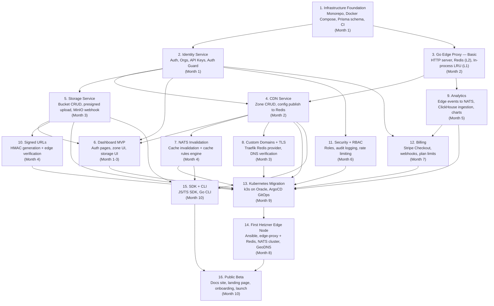

# Phase 1 — Development Flow

Source: [`docs/superpowers/specs/2026-06-29-revocloud-phase1-cdn-edd.md`](superpowers/specs/2026-06-29-revocloud-phase1-cdn-edd.md) — Section 10 (Development Roadmap) and Section 11 (Development Order).

Build sequence and dependencies for RivoCloud Phase 1 (CDN), grouped by the 16 build stages from the Development Order, annotated with their target roadmap month.

## Notes

- Arrows represent build dependencies ("depends on"), not runtime call direction.
- Stage numbers and month labels match Section 11 (Development Order) and Section 10 (Development Roadmap) of the Phase 1 EDD respectively — the two sections don't perfectly align chronologically (e.g. Kubernetes is ordered before the first edge node in Section 11, but scheduled a month after it in Section 10); this diagram follows the dependency order in Section 11.
- Excluded from Phase 1 (see Section 1 of the EDD): image/video processing, Edge Functions, AI/semantic caching, API Gateway, multi-region Postgres, BGP Anycast, customer webhooks, object versioning UI, lifecycle policy execution.
